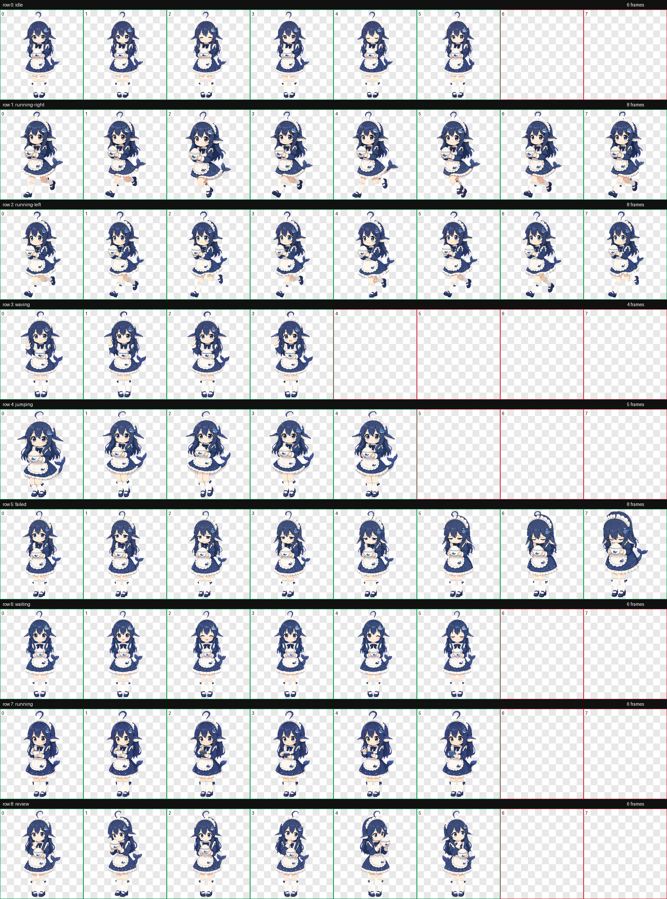

# 大肥鱼 (dafeiyu)

A fan-made OpenPets desktop pet: a chibi whale-girl maid inspired by the
DeepSeek mascot 小鲸 / DeepSeek酱 — navy hair with a hook-shaped ahoge, fin
ears, white frilled headdress, rice bowl, and a tail. She sits on your
desktop, and with the integration plugins in this repo she reacts in real
time while your AI coding agents work.

- **9 animation states.** Idle, run (left/right), wave, jump, fail, wait,
  task-work, and review — 57 frames on the standard 1536×1872 OpenPets V1
  atlas.
- **Lightweight.** ~1.2 MB WebP spritesheet (1,214,382 bytes); installs from
  a folder or a zip.
- **Agent-aware.** Ships a [DSH plugin](openpets-dsh/) and an
  [OpenCode V2 plugin](opencode-v2/) that drive her reactions from live
  agent events: thinking, working, success, error, waiting for approval.
- **Standard format.** Built with the
  [openpet-hatchery](https://github.com/chenmi319/openpet-hatchery)
  pipeline; works with any OpenPets-compatible desktop app.



Per-state GIFs live in [`previews/`](previews/): `idle`, `running`
(`-left` / `-right`), `waving`, `jumping`, `waiting`, `review`, `failed`.

## Install

Requires an OpenPets-compatible desktop app.

```sh
npx -y install-pet dafeiyu
# or, from a local clone / downloaded zip:
openpets install --from-folder ./dist/dafeiyu
openpets install --from-zip ./dist/dafeiyu.zip
```

## Make her react to your agents

A pet that only idles is half the fun. This repo ships two bridges that map
coding-agent events to pet reactions:

- **[openpets-dsh/](openpets-dsh/)** — DeepSeek Harness plugin. Thinking
  while the model generates, working while tools run, success when the turn
  ends, error when it fails, waiting when approval is needed. Install:
  `dsh plugin --profile <name> add ./openpets-dsh`.
- **[opencode-v2/](opencode-v2/)** — OpenCode V2 port of
  `@open-pets/opencode`, plus agent instructions for the OpenPets MCP tools.

Both bridges can run at once and drive **different** pets, so each agent gets
its own companion — bind each one explicitly (`pet: dafeiyu` for DSH,
`options.pet` for OpenCode) rather than leaving it to the app's default pet.

## Package

- `dist/dafeiyu/pet.json` + `dist/dafeiyu/spritesheet.webp` — installable pet folder
- `dist/dafeiyu.zip` — zipped package (files at zip root)
- `previews/` — per-state animation GIFs + contact sheet
- `opencode-v2/` — OpenCode V2 integration assets (plugin port + agent instructions)
- `openpets-dsh/` — DSH plugin bundle: drives the pet from DSH agent events

## Rights

Fan-made unofficial fan art. Character artwork was AI-generated, derived from
the DeepSeek mascot design, then assembled and packaged into the OpenPets
format. Not affiliated with or endorsed by DeepSeek. No ownership claimed over
DeepSeek's name, trademarks, or the original character artist's rights.
